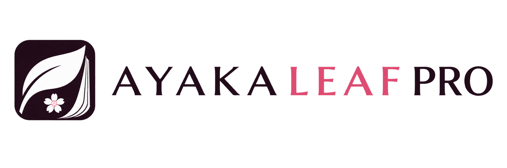
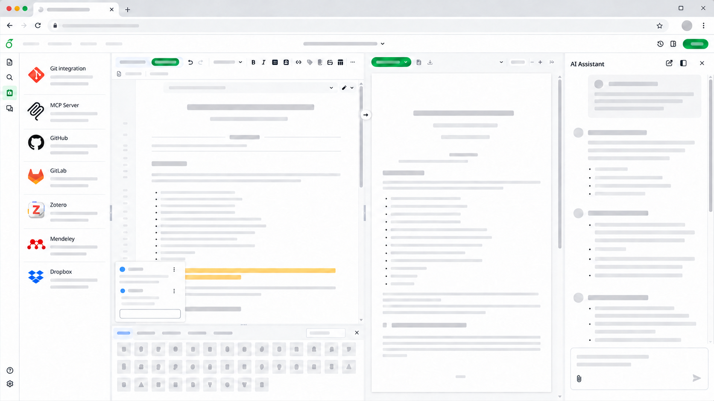

<h1 align="center">
   
  
</h1>

<h4 align="center">Overleaf Community Edition melhorado com todas as funcionalidades Pro  (código aberto, de uso gratuito, auto-hospedável).</h4>

  <a href="https://ayakaleaf-pro.ayaka.space">Documentação</a> •
  <a href="https://github.com/ayaka-notes/ayakaleaf-pro-playground">Playground</a> •
  <a href="https://ayakaleaf-pro.ayaka.space/blog">Blog</a> •
  <a href="https://github.com/orgs/ayaka-notes/packages/container/package/overleaf-pro">Imagem Docker</a> •
  <a href="https://github.com/ayaka-notes/texlive-full">TeXLive</a> •
  <a href="https://ayakaleaf-pro.ayaka.space/dev">Desenvolvedores</a> •
  <a href="#autores">Autores</a> •
  <a href="#licença">Licença</a>

  <a href="../README.md">English</a> ·
  <a href="README-CS.md">Čeština</a> ·
  <a href="README-DA.md">Dansk</a> ·
  <a href="README-DE.md">Deutsch</a> ·
  <a href="README-ES.md">Español</a> ·
  <a href="README-FI.md">Suomi</a> ·
  <a href="README-FR.md">Français</a> ·
  <a href="README-IT.md">Italiano</a> ·
  <a href="README-JP.md">日本語</a> ·
  <a href="README-KR.md">한국어</a> ·
  <a href="README-NL.md">Nederlands</a> ·
  <a href="README-NO.md">Norsk</a> ·
  <a href="README-PL.md">Polski</a> ·
  <b>Português</b> ·
  <a href="README-RU.md">Русский</a> ·
  <a href="README-SV.md">Svenska</a> ·
  <a href="README-TR.md">Türkçe</a> ·
  <a href="README-ZH.md">简体中文</a>

  Figura 1: Captura de tela de um projeto sendo editado no Ayakaleaf Pro Edition.

## Ayakaleaf Pro Edition
O Ayakaleaf Pro é uma versão melhorada do Overleaf com quase todas as funcionalidades e capacidades. Para mais detalhes, confira a página [Ayakaleaf Pro](https://ayakaleaf-pro.ayaka.space). As funcionalidades do Ayakaleaf Pro incluem:

- Sincronização bidirecional com o Dropbox (mantenha todos os seus projetos sincronizados com o Dropbox)
- Servidor MCP (permita que agentes de IA editem, compilem e comentem)
- Assistente de chat com IA (converse, edite e corrija com IA)
- Assistente de erros (explica e corrige erros de compilação)
- Importação/exportação com Pandoc (converta Word, Markdown e LaTeX)
- Execução de scripts Python (execute Python no seu projeto)
- Sincronização bidirecional com o GitHub (Enterprise) (push e pull com o GitHub)
- Sincronização bidirecional com o GitLab (GitLab.com ou GitLab auto-hospedado)
- Sincronização bidirecional com o Gitea (Gitea.com ou Gitea auto-hospedado)
- Integração com o Zotero (com suporte para Zotero OAuth)
- Integração com o Mendeley (com suporte para Mendeley OAuth)
- Pesquisa avançada de referências (pesquise em todas as suas entradas Bib)
- Suporte para Git-Bridge (clone, pull e push com Git)
- Painel de administração (gerenciamento global de usuários/projetos)
- SSO com LDAP e SAML ou OAuth 2.0
- Tempo de compilação ilimitado (ajustável no painel de administração)
- Autocadastro (opcional, pode ser limitado por domínio de e-mail)
- Compilação em sandbox (com suporte para a imagem [texlive-full](https://github.com/ayaka-notes/texlive-full))
- Sistema de modelos (com galeria de modelos)
- Controle de alterações (com painel de revisão e comentários)
- Histórico completo do projeto (com restauração e download)
- Paleta de símbolos (insira símbolos matemáticos com um clique)
- Tradução i18n completa (todos os textos da interface em 18 idiomas)
- Suporte para ARM (x86_64/arm64 em Docker)

Por último, mas não menos importante, o Ayakaleaf Pro é de código aberto e pode ser usado e modificado gratuitamente. Você pode hospedá-lo por conta própria e contribuir para o desenvolvimento do Ayakaleaf Pro. Para mais detalhes, confira a página [Documentação para desenvolvedores](https://ayakaleaf-pro.ayaka.space/dev).

> [!NOTE]
> Nota: o Ayakaleaf Pro não tem qualquer afiliação com a Overleaf, Inc. nem com sua empresa controladora, Digital Science. Também *não é* a edição *Server Pro*, que é um produto comercial oferecido pela Overleaf, Inc.
> 
> O Ayakaleaf Pro é um projeto independente desenvolvido e mantido pela [ayaka-notes](https://github.com/ayaka-notes).

## Instalação

Se você quiser apenas experimentar o Ayakaleaf Pro sem configurar um servidor, pode usar o nosso [Ayakaleaf Pro Playground](https://github.com/ayaka-notes/ayakaleaf-pro-playground). Ele oferece um ambiente GitHub Codespaces pré-configurado que permite iniciar e explorar o Ayakaleaf Pro diretamente no seu navegador.

Se você quiser implantar o Ayakaleaf Pro para uso em produção, temos instruções de instalação detalhadas na página [Documentação](https://ayakaleaf-pro.ayaka.space/). Recomendamos fortemente instalar o Ayakaleaf Pro usando o [ayaka-notes/Toolkit](https://github.com/ayaka-notes/toolkit/).

## Atualização

Se você estiver atualizando a partir de uma versão anterior do Ayakaleaf Pro, confira a [página de versões](https://github.com/ayaka-notes/ayakaleaf-pro/releases) para ver as alterações de cada versão entre a sua versão atual e aquela para a qual você está atualizando.

## Traduções

Contribuições para as traduções do Ayakaleaf Pro são bem-vindas. Geralmente, usamos claude/codex para traduzir o texto em inglês para outros idiomas. Se você encontrar erros nas traduções, envie um pull request para corrigi-los. Modifique apenas os arquivos relevantes na pasta `services/web/locales/locales_patches`.

Os arquivos em `services/web/locales/` são os arquivos de tradução oficiais do Overleaf. Não os modifique diretamente.

## Contribuir

Confira o arquivo [CONTRIBUTING](../CONTRIBUTING.md) para obter informações sobre como contribuir para o desenvolvimento do Overleaf.

## Blog
Escrevemos sobre o funcionamento interno do Overleaf, o desempenho da compilação e infraestrutura LaTeX auto-hospedada. Leia mais no nosso blog:
- [2026.08 Overleaf Server Pro Price and Open-Source Alternative](https://ayakaleaf-pro.ayaka.space/blog/2026/overleaf-server-pro-price-and-open-source-alternative)
- [2026.08 Overleaf Benchmark: A Deep Research of Concurrent LaTeX Compilation in Overleaf](https://ayakaleaf-pro.ayaka.space/blog/2026/overleaf-benchmark)

## Autores

- [A equipe do Overleaf](https://www.overleaf.com/about)
- [Funcionalidades e direitos autorais](https://ayakaleaf-pro.ayaka.space/on-premises/readme/features-and-copyright)

## Licença

O código neste repositório é distribuído sob a GNU AFFERO GENERAL PUBLIC LICENSE, version 3. Uma cópia pode ser encontrada no arquivo [`LICENSE`](../LICENSE).

- Copyright (c) Overleaf, 2014-2025.
- Copyright (c) [Pro Authors](https://ayakaleaf-pro.ayaka.space/on-premises/readme/features-and-copyright), 2026-now.

## Patrocinadores
- [Vultr](https://www.vultr.com/)
- [Linux Do Community](https://linux.do)
- [OpenAI Codex OSS](https://openai.com/en/form/codex-for-oss/)
- [GitBook](https://www.gitbook.com/)

## Star History

<a href="https://www.star-history.com/?repos=ayaka-notes%2Fayakaleaf-pro&type=date&legend=top-left">
 <picture>
   <source media="(prefers-color-scheme: dark)" srcset="https://api.star-history.com/chart?repos=ayaka-notes/ayakaleaf-pro&type=date&theme=dark&legend=top-left&sealed_token=u3l5zBKFPuzl3y_xdCmqTPT_5iaimMLJchJaALvNsAR3LtSu2NrnvjlmbfGW1NdyDch3XLj-o6rfTpyk2K7s6gtgdzDvrDAsTkBnGz_m2CAkbq0IvxsFXPzEkypDT3vhHvYsvDu3qd7Dx6LcPFy_330a0kqmByAl6FKN-13QCGuo1LTv0iEUihWDTUlz" />
   <source media="(prefers-color-scheme: light)" srcset="https://api.star-history.com/chart?repos=ayaka-notes/ayakaleaf-pro&type=date&legend=top-left&sealed_token=u3l5zBKFPuzl3y_xdCmqTPT_5iaimMLJchJaALvNsAR3LtSu2NrnvjlmbfGW1NdyDch3XLj-o6rfTpyk2K7s6gtgdzDvrDAsTkBnGz_m2CAkbq0IvxsFXPzEkypDT3vhHvYsvDu3qd7Dx6LcPFy_330a0kqmByAl6FKN-13QCGuo1LTv0iEUihWDTUlz" />
   
 </picture>
</a>
